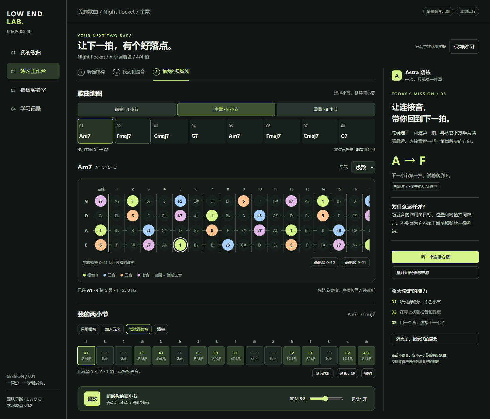

# LOW END LAB · 贝斯乐理学习 Agent

面向正在学习乐理的贝斯手：从一首歌出发，观察节拍与小节、理解和弦，再把和弦音映射到四弦贝斯指板，配合中文问答与循环练习学习编配。

当前应用版本 **v0.7.0**，已加入多数据集评测工具。项目仍在开发中，识别结果是候选，尤其复杂爵士、三拍和节拍变化尚未达到稳定自动分析的目标。



## 当前功能

- **音频工作台**：导入 MP3/WAV/FLAC/OGG，生成波形，播放、变速、定位与区间循环；原音频和校正保存在本机。
- **节奏与小节**：Beat This! small0 在 CPU 上识别拍点/强拍；统一播放提示与小节时间轴，支持拍点检查、分段分组、人工校正、撤销和保存。
- **和弦分析**：BTC 170 类模型进行重叠窗口推理，结合小节、持续时长及音高证据生成和弦候选，保留原始输出和未知区间。
- **四弦贝斯指板与乐理卡**：标准 E–A–D–G 调弦、0–21 品；显示音名、音程与和弦音，支持根音/和弦音练习及保守学习建议。
- **中文乐理问答**：可选百炼 Qwen 服务，结合知识条目和明确的曲目上下文回答。只发送文字，不上传音频；低温度不能保证答案正确。
- **分析与学习记录**：声学变化段落候选、区间回听、校正版本、JSON 导出。主歌/副歌语义识别与自动完整贝斯 jam 生成尚未实现。
- **评测工具**：GTZAN → GuitarSet → POP909-CL 顺序导入；区分原始模型、参考节拍和预测节拍完整流程，记录覆盖率、匹配准确率及连续性。

## Windows 启动

需要 Python 3.10；安装用的默认 Python 还需有支持 `--python` 的 pip（建议 pip 23+）。首次安装会联网下载依赖和两个模型权重。

```powershell
# 在克隆后的仓库根目录执行。
powershell -ExecutionPolicy Bypass -File .\outputs\audio-analysis\install.ps1
& .\outputs\启动音频分析.cmd
```

打开 <http://127.0.0.1:8765/#analysis>。服务仅供本机使用；本地节拍与和弦识别无需 API Key。静态打开 `outputs/index.html` 可使用原型功能，真实音频分析需要运行服务。

可选中文问答：双击 `outputs/配置Qwen问答.cmd`，在本机填入自己的百炼地址和 API Key。配置保存在被 Git 忽略的 `work/private/qwen.json`。每个使用者需要自行配置服务，API 调用可能收费；详见 [Qwen 配置说明](outputs/audio-analysis/QWEN-配置说明.md)。

## 当前评测与限制

已经导入 GTZAN 1,000 段、GuitarSet 360 段和 POP909-CL 906 首 MIDI，完成 27 次初始诊断任务。**跑完不等于准确性达标，也不是全库测试通过。**

| 初始诊断 | 原始模型 | 参考节拍下整理 | 预测节拍完整流程/规则处理 |
|---|---:|---:|---:|
| GTZAN 10 段逐拍 F1，±70 ms | 92.56% | — | 92.94% |
| GTZAN 同批强拍 F1 | 69.01% | — | 60.83% |
| GuitarSet 10 段伴奏三和弦匹配 | 63.48% | 69.15% | 53.60% |
| POP909 3 首合成长曲三和弦匹配 | 83.16% | 87.79% | 34.78% |

和弦分数按标注时长加权。GuitarSet 与 Beat This! 上游训练来源重叠；POP909 是合成音频及全谱数学网格，不能直接代表真实原曲准确率。诊断集和冻结测试集分开，本轮没有用冻结测试集调参。

源码仓库不包含用户音频、下载的数据集、全部逐曲标注、模型权重、Python 虚拟环境或 API Key。模型由安装器下载，数据集由评测脚本按需取得。已保存汇总报告；完整数据与中间推理记录需要在本机生成。

## 接下来优化什么

1. **优先修复小节分组**：首拍相位、倍半拍、三拍/swing/变拍以及长曲连续性，减少节奏错误向和弦分析传递。
2. **提高可靠输出的覆盖率**：保留不确定性提示，同时避免节拍不确定导致整段和弦结果被过度拒绝；区分根音可靠和完整和弦可靠。
3. **加强真实音频评测**：作品级去重、活动区间与休止分开评分，补充真实爵士与变拍标注；版本锁定后再做冻结测试集验收。
4. **按证据决定微调**：先定位规则与网络误差。必要时分别微调 Beat This! 或 BTC，先做短训练和显存实测；当前不需要立即租 GPU。
5. **推进教学与 jam**：提高中文回答的依据可追溯性，逐步开发按小节的根音节奏、和弦音连接与加花建议，再延伸到可播放的贝斯编配。

## 开发和评测

```powershell
$labPython = '.\outputs\audio-analysis\.venv\Scripts\python.exe'
& $labPython -m unittest discover -s outputs/audio-analysis/tests -p 'test_*.py'
node outputs/fretboard-model.test.cjs
node outputs/audio-analysis/tests/theory.test.cjs
node outputs/audio-analysis/tests/rhythm-grid.test.cjs
node outputs/audio-analysis/tests/harmony-structure.test.cjs

# 可选评测依赖及适配器测试。
& $labPython -m pip install -r outputs/audio-analysis/evaluation/requirements.txt
& $labPython outputs/audio-analysis/evaluation/test_dataset_adapters.py
```

JavaScript 测试与数据集完整流程需要 Node.js。更多操作见 [数据集操作说明](outputs/audio-analysis/evaluation/DATASETS.md)。

## 文档

- [产品需求与教学设计](outputs/01-产品需求与教学设计.md)
- [指板数学模型](outputs/02-指板数学模型与接口.md)
- [资料来源与知识库方案](outputs/04-资料来源与知识库方案.md)
- [数据集接入、评测结果与训练资源评估](outputs/20-数据集接入与训练资源评估.md)
- [机器可读评测汇总](outputs/audio-analysis/evaluation/dataset-import-2026-11-09/summary.json)
- [第三方来源与许可说明](THIRD_PARTY_NOTICES.md)

`outputs` 中按编号保存设计与开发记录；旧记录中的“未实现/未配置”描述对应当时版本，当前状态以本页为准。部分历史记录中的本机绝对路径、音频和大体积附件不随源码发布。
